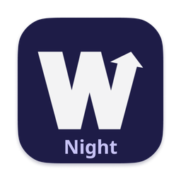
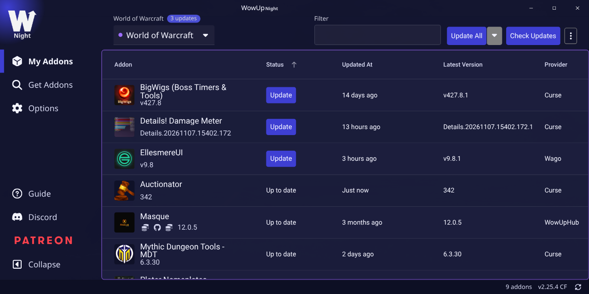

<p align="center">
  
</p>

<h1 align="center">WowUpNight</h1>

<p align="center">
  A fork of <a href="https://wowup.io">WowUp</a>, the World of Warcraft addon manager, rebuilt as a
  small native app for Windows, macOS and Linux.
</p>

<p align="center">
  <a href="https://github.com/alijohnzy/WowUpNight/releases/latest"><b>Download</b></a>
  &nbsp;·&nbsp;
  <a href="#support-wowup-and-the-addon-authors"><b>Support WowUp</b></a>
</p>



> **WowUpNight is an unofficial fork.** WowUp is the work of the
> [WowUp team](https://github.com/WowUp/WowUp), and nearly everything you see here — the addon
> sources, the scanning and matching, the updating, the design — is theirs. This fork is not made,
> endorsed or supported by them, so please report WowUpNight problems
> [here](https://github.com/alijohnzy/WowUpNight/issues), not to WowUp. If you find it useful,
> [support the original](#support-wowup-and-the-addon-authors).

## What is different

- **Small.** Built on [Tauri](https://tauri.app) and [Svelte](https://svelte.dev) instead of
  Electron and Angular, it uses the webview your system already has rather than shipping its own
  browser. Downloads are 11–15 MB, against about 130 MB for the Electron build.
- **A colour for each WoW version.** Retail, Classic, Anniversary, the PTRs and the rest each get
  their own colour, taken from their logos: the addon lists are framed in it, and the version list
  marks each one, so you always know which game you are looking at. Pick your own in Options →
  Clients.
- **Set up one WoW version from another.** Get Addons marks the addons you already have in
  your other WoW versions, and right-click the Addon column header → **Missing from this client**
  lists only the ones the selected version lacks. On My Addons, right-click an addon → **Copy
  settings from** to bring its settings over from another version; your interface settings are
  backed up first.
- **Filter by provider.** Right-click the Provider column header on My Addons or Get Addons to
  show only CurseForge, only Wago, or any mix.
- **Night look**, with light animations that can be turned off in Options → Application.
- **Updates itself** from this repository's releases on all three systems. If an update goes
  wrong, right-click the update button in the footer to go back to an earlier build.
- **Stays out of the way.** With Minimize on Close it waits in the system tray, and on a Mac in
  the menu bar alone, without a Dock icon.

Everything else is WowUp: CurseForge, Wago, WowInterface, GitHub and its other addon sources,
search and categories, several WoW installations at once, automatic updates, WTF backups and the
[companion addon](https://github.com/WowUp/WowUp.Addon).

What each build changed is at the top of its
[release page](https://github.com/alijohnzy/WowUpNight/releases), and in the app under
Options → About.

## Download

From the [latest release](https://github.com/alijohnzy/WowUpNight/releases/latest):

| System | File |
|---|---|
| Windows 10 and 11 | `WowUpNight_…_x64-setup.exe`, or `WowUpNight-…-portable.zip` to run without installing |
| macOS, Apple Silicon (M1 and newer) | `WowUpNight_…_aarch64.dmg` |
| Linux | `WowUpNight_…_amd64.AppImage`, or the `.deb` |

None of the builds are signed by a paid certificate, so the first launch needs one extra step:

- **Windows:** SmartScreen says "Windows protected your PC". Click **More info → Run anyway**.
- **macOS:** drag WowUpNight to Applications and open it. macOS refuses it the first time; go to
  **System Settings → Privacy & Security** and click **Open Anyway**. Or, once, in Terminal:
  `xattr -dr com.apple.quarantine /Applications/WowUpNight.app`
- **Linux:** the app uses the system's WebKitGTK 4.1. If it is missing:
  `sudo pacman -S webkit2gtk-4.1` (Arch, Manjaro), `sudo apt install libwebkit2gtk-4.1-0`
  (Debian, Ubuntu) or `sudo dnf install webkit2gtk4.1` (Fedora).

**Already using WowUp?** On its first start WowUpNight copies your WoW installations and addon
list from an existing WowUp install on the same computer. The two keep separate settings after
that, and can be installed side by side.

## Support WowUp and the addon authors

WowUpNight exists because WowUp does. If it saves you time, please support the people who made
it:

- [WowUp on Patreon](https://www.patreon.com/jliddev) — the **Sponsor** button at the top of this
  page goes there too
- [WowUp on Discord](https://discord.gg/rk4F5aD) and [wowup.io](https://wowup.io)

The Wago and CurseForge panel in the app is what those services ask for in return for letting
WowUp use them, and it helps pay the addon authors. The authors of your favourite addons often
take donations as well — it is usually on their addon's page.

## Building

You need Node.js 24, Rust (stable), and on Linux the WebKitGTK development packages
([Tauri's prerequisites](https://tauri.app/start/prerequisites/)).

```bash
cd wowup-lib && npm install && npm run build
cd ../wowup-electron && npm install
cd renderer-svelte && npm install && cd ..
npm run tauri:dev      # run it
npm run tauri:build    # installers in src-tauri/target/release/bundle/
```

Where things are:

| | |
|---|---|
| [`wowup-electron/src-tauri/`](wowup-electron/src-tauri/) | the app itself, in Rust: files, addon installs, the WoW client detection, updates |
| [`wowup-electron/renderer-svelte/`](wowup-electron/renderer-svelte/) | the interface, in Svelte 5 |
| [`wowup-lib/`](wowup-lib/) | WowUp's shared addon library |
| [`.github/workflows/tauri-build.yml`](.github/workflows/tauri-build.yml) | builds and publishes the releases |

The Electron and Angular code from WowUp is still in the tree, unused by WowUpNight, so that
WowUp's own changes keep merging in cleanly.

## Keeping up with WowUp

The `master` branch is a copy of [WowUp/WowUp](https://github.com/WowUp/WowUp). Their changes are
merged into `main`, and the parts this fork rewrote are ported by hand.

WowUpNight began as an experiment in measuring a framework migration on a real app; the
measurements and write-ups are in [`wowup-electron/migration/`](wowup-electron/migration/).

## License

[GNU General Public License v3.0](LICENSE), the same as WowUp. The original work is copyright
WowUp LLC; this fork's changes are released under the same license.

WowUpNight is not affiliated with or endorsed by WowUp LLC, Blizzard Entertainment, CurseForge or
Wago. World of Warcraft is a trademark of Blizzard Entertainment.
